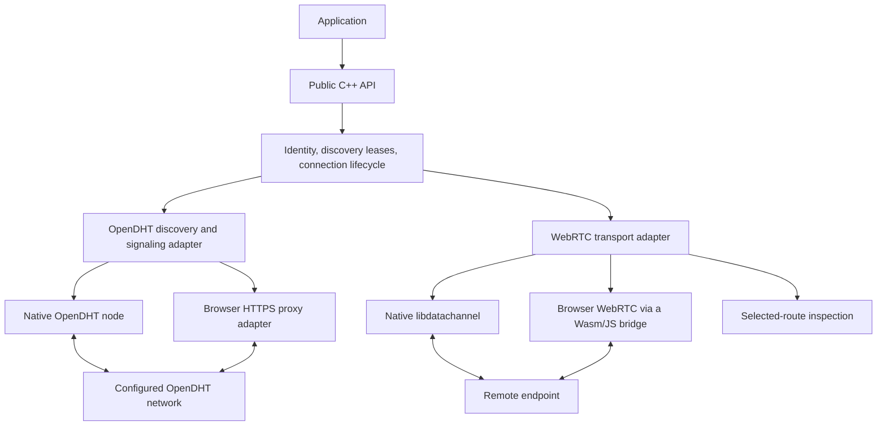

# Plan: p2p-discovery-connect

Status: proposed library design. Decisions recorded on **12 November 2026**.

## 1. Decisions and purpose

The chosen networking architecture is:

- **OpenDHT for peer discovery and connection signaling.**
- **WebRTC Data Channels for connections and application data.**
- **TURN support**, with an API that reports whether the selected connection
  actually uses a TURN relay.
- Native targets: **Windows, Linux, macOS, iOS, and Android**.
- Browser target: **WebAssembly**, with browser APIs behind platform adapters.

The library is named **`p2p-discovery-connect`**. It provides a small asynchronous
C++ interface for announcing a discoverable endpoint, finding peers, connecting,
accepting connections, exchanging binary messages, and observing connectivity.

**First alpha scope:** Linux, browser WebAssembly, and Android. Windows, macOS,
and iOS remain later targets. The alpha still requires an actual Android build
and runtime validation, plus browser testing beyond the Chromium coverage
currently available; cross-compilation alone is not runtime evidence.

**This is a general-purpose library. It is not a Yjs/Yrs library.** Yjs/Yrs is
a reference workload establishing minimum requirements for binary transport,
large messages, flow control, and reconnect notifications. Applications own their
document model, synchronization protocol, persistence, permissions, and undo.

The library must be independent of Xournal++, the planned drawing application,
Qt, and any CRDT implementation. This plan lives beside the Xournal++ reference
checkout; the eventual library should have its own source/build tree.

## 2. Scope and boundaries

### Public responsibilities

1. Start and stop a local endpoint with a stable cryptographic peer identity.
2. Announce that endpoint under an application-supplied discovery capability.
3. Watch for compatible endpoints under that capability.
4. Exchange authenticated connection offers, answers, and ICE candidates.
5. Establish authenticated WebRTC Data Channel connections with TURN available.
6. Send and receive opaque, message-delimited binary payloads with bounded memory.
7. Report discovery health, connection state, selected route, and failures.

### Responsibilities above the library

- Document IDs, rooms with application membership rules, CRDT updates, awareness
  payloads, application-level acknowledgments, and resynchronization.
- Files, databases, offline queues, and permanent availability of peer content.
- Multi-peer broadcast, gossip, forwarding, and large-group topology management.
- Account identities spanning several devices; library peer identities identify
  endpoints, not human users.
- Audio/video, Git synchronization, and application UI.

The first release connects individual peer pairs. An application can maintain
several connections, but the library does not promise that discovering a set of
peers establishes a mesh or distributes a message to all of them.

## 3. Architecture



Use **C++20 and CMake**. Public headers use library-owned types and standard C++
types; they do not expose OpenDHT, GnuTLS, `rtc::*`, JavaScript, or Qt types.
**Hard requirement:** the same C++ library-user source code must compile and run
against the native library and its WebAssembly build, without platform-specific
branches or a separate JavaScript application API. Platform adapters select the
native OpenDHT/WebRTC implementation or browser proxy/WebRTC APIs internally.
Configuration can provide both native bootstrap addresses and a browser HTTPS
gateway; the same application code supplies it on every target. Browser event
loop and network availability constraints still apply.
Use opaque implementations so backend upgrades do not spread into consumers.
No ABI-stability promise is needed for the first release; version the wire
protocol independently of the package API.

Backend candidates and evidence:

- Native discovery/signaling: **OpenDHT**. Its documented public-network example
  bootstraps through `bootstrap.jami.net:4222`; bootstrap addresses remain
  configurable. This is a documented example, not a service-availability promise.
  [OpenDHT project](https://github.com/savoirfairelinux/opendht).
- Browser discovery/signaling: an **HTTPS OpenDHT proxy adapter**. The REST API
  offers get, put, and streaming listen operations. Browser access additionally
  requires a suitable HTTPS/CORS deployment; access to an arbitrary public
  bootstrap node does not imply access to a browser-compatible proxy.
  [OpenDHT REST API](https://github.com/savoirfairelinux/opendht/wiki/REST-API).
- Native transport: **libdatachannel**, initially with media disabled.
  [Project and platform support](https://github.com/paullouisageneau/libdatachannel).
- Browser transport: evaluate **datachannel-wasm**, extending it or using a small
  direct JavaScript bridge where its API is insufficient. It exposes a subset of
  the native API, not full feature parity.
  [Browser wrapper](https://github.com/paullouisageneau/datachannel-wasm).
- Portable identity/signaling cryptography: prefer **libsodium**, using its native
  and Emscripten builds. Fix the interoperable encoding and cryptographic suite
  before publishing protocol v1; use existing primitives rather than designing
  cryptographic algorithms. [Build targets](https://doc.libsodium.org/installation).

**DHTNet is a reference, not a dependency in this design.** We are using OpenDHT
as a discovery/signaling service and WebRTC as the common native/browser data
transport. This does not provide wire interoperability with Jami or DHTNet apps.

## 4. Small public interface

Three main objects are sufficient:

- **`Node`**: one running endpoint, identity, and backend configuration.
- **`PeerAdvertisement`**: a verified, expiring discovery result that can be dialed.
- **`Connection`**: an authenticated link with binary messaging and route status.

Additional handles are small lifetime/cancellation objects: `Lease`,
`Subscription`, `Operation`, and `IncomingRequest`.

### Illustrative API

This is an interface sketch, not a compilable header. `Completion<T>` carries a
typed result; `Bytes` owns its storage; `ByteView` is a borrowed read-only span.

```cpp
namespace p2pdc {

enum class Delivery { ReliableOrdered, Ephemeral };
enum class RelayPolicy { Automatic, RequireLocalRelay };
enum class ConnectionState {
    Connecting, Authenticating, Ready, Suspended, Closed, Failed
};
enum class RouteKind { Unknown, Direct, TurnRelayed };
enum class TurnHistory { Unknown, NotUsed, Used };
enum class SendResult {
    Accepted, Backpressure, TooLarge, NotReady, Unsupported
};

struct RouteInfo {
    RouteKind current;
    TurnHistory turn_history;
    std::optional<CandidateKind> local_candidate;
    std::optional<CandidateKind> remote_candidate;
    TimePoint observed_at;
};

struct ConnectionHandlers {
    Function<void(ConnectionState)> on_state;
    Function<void(RouteInfo)> on_route;
    Function<void(ReceivedMessage)> on_message;
    Function<void(Delivery)> on_writable;
    Function<void(Error)> on_error;
};

class Connection {
public:
    PeerId peer() const;
    ConnectionId id() const;
    ConnectionState state() const;
    RouteInfo route() const;
    ConnectionLimits limits() const;
    SendResult send(ByteView payload,
                    Delivery mode = Delivery::ReliableOrdered);
    void close();
};

class Node {
public:
    static Result<Node> create(Config, Executor, NodeHandlers);
    PeerId peer_id() const;
    Operation start(Completion<void>);
    Lease announce(DiscoveryCapability, AnnounceOptions);
    Subscription watch(DiscoveryCapability, DiscoveryHandlers);
    Operation connect(PeerAdvertisement, ConnectOptions,
                      ConnectionHandlers, Completion<Connection>);
    void shutdown(Completion<void>);
};

class IncomingRequest {
public:
    PeerAdvertisement peer() const;
    Operation accept(ConnectOptions, ConnectionHandlers,
                     Completion<Connection>);
    void reject();
};

} // namespace p2pdc
```

`NodeHandlers::on_incoming` receives authenticated incoming requests; the default
is rejection unless the application supplies an acceptance policy. Applications
can accept asynchronously within a configurable request deadline.

`DiscoveryHandlers` reports `Seen`, `Updated`, and `Expired` advertisements plus
discovery health. Advertisement expiry means the announcement became stale; it
is not proof that the peer deliberately left or disconnected.

`AnnounceOptions` and `ConnectOptions` contain timeouts and limits, not document
or CRDT options. Versions and transport capabilities are library metadata.
Applications carry their own protocol information after connecting.

### Configuration

`Config` contains:

- A local identity or explicit identity-generation request. Persistence/export
  of the private identity is an application choice; logs never contain its keys.
- OpenDHT bootstrap addresses and network configuration for native operation.
- One or more HTTPS gateway addresses for browser operation, optionally native
  proxy operation. Expose which discovery backend is in use and its health.
- STUN/TURN URLs and a TURN credential provider. Obtain credentials per attempt,
  account for expiry, and avoid embedding service secrets in shipped binaries.
- Defaults for relay policy, operation deadlines, and resource limits.

`Executor` posts callbacks onto the application's chosen execution context. It
must work with a desktop event loop, a standalone test loop, and the browser.
Initialization that needs asynchronous browser crypto belongs in `start`, not
in a blocking constructor.

### Execution and ownership contract

- Public operations are called on the supplied executor; backend threads marshal
  events back to it. Document this instead of promising arbitrary thread safety.
- Callbacks are serialized, posted asynchronously, and never invoked inline by
  the initiating call. Keep the browser main thread nonblocking.
- `send(Accepted)` copies or takes ownership of the entire payload before return.
  `on_message` receives an owning buffer that may be retained by the caller.
- Canceling an `Operation` completes it once with `Canceled`, unless it already
  completed. A successful connection belongs to its `Connection` handle.
- Dropping a `Lease` stops refresh; dropping a `Subscription` stops future watch
  callbacks, including callbacks already queued but not delivered.
- `shutdown` closes connections and cancels outstanding work. Its completion is
  the final callback for that node. Late backend callbacks cannot revive it.
- Handle destruction never blocks waiting for networking. Define safe cleanup
  when the application tears down without awaiting graceful shutdown.

## 5. Discovery and signaling protocol

### Discovery

Use an application-provided, high-entropy **`DiscoveryCapability`**, suitable for
sharing through an invitation link or QR code. It is a discovery-group secret,
not a document ID or an application authorization decision.

Derive namespaced DHT lookup keys from it. A predictable room name or its hash
must not be described as access control. Encrypt advertisement bodies with a
capability-derived key, and sign their canonical contents with endpoint identity.

An advertisement contains protocol version, public identity, recipient-encryption
public key, per-start `InstanceId`, signaling inbox, sequence number, supported
features, issue time, and short expiry. Public keys must be bound together by
the signature. `PeerId` is derived from the public signing key; it is unrelated
to a CRDT client/actor ID.

Refresh announcements under a lease. Validate signatures, size, expiry,
sequence/freshness, and versions before emitting a discovered peer. Handle clock
skew explicitly. Closing a lease cannot guarantee immediate removal from a
distributed store; listeners ignore expired announcements even if retained.

Discovery is eventually observed and can be incomplete. A peer announcement is
an invitation to attempt a connection, not proof of reachability.

### Signaling

Use separate per-instance mailboxes on OpenDHT for offers, answers, trickled ICE
candidates, cancellation, and rejection. Each envelope includes sender/recipient,
instance IDs, a random attempt ID, message sequence, expiry, and protocol version.
Sign and encrypt signaling using portable client-side cryptography. Do not ask
a public proxy to hold or use the endpoint's private keys.

Bind the signed SDP, including its DTLS fingerprint, to the intended peer and
attempt. Native and browser peers verify the same envelope bytes. A proxy or
DHT node must not be able to substitute an unauthenticated connection identity.
Default identity policy rejects key mismatches; trusting a new peer remains an
explicit application decision, including capability-based acceptance if desired.

The signaling state machine must cover:

- Duplicate, delayed, missing, and out-of-order records.
- ICE candidates arriving before the remote description.
- Simultaneous connection attempts, with a documented deterministic initiator
  tie-break and convergence to one link for the same endpoint pair.
- Stale records from a previous process or attempt; replay/resource bounds.
- Peer disappearance, timeout, explicit rejection, and cancellation.
- Batching and bounded chunking of signaling records to fit DHT value limits.
- Multiple gateway attempts, subscription recovery, and mailbox catch-up reads.

Specify a compact versioned wire format with fixed field encodings and bounds.
Do not serialize native C++ structs, pointer values, or platform-dependent sizes.
Pin record size/refresh limits only after measuring the selected OpenDHT backend;
per-pen-sample publication and document transfer through the DHT are out of scope.

For browser access, use the documented REST get/put/listen routes, handle streamed
JSON boundaries correctly, and test HTTPS, CORS, timeout, and reconnect behavior.
Public OpenDHT bootstrap availability is separate from public proxy availability;
the project must document which gateways it operates, uses, or expects consumers
to supply. Do not silently choose a third-party gateway.

## 6. Connection and message semantics

One connection uses a reliable control/handshake path and application Data
Channels. Reserve versioned channel labels internally; application payloads
remain opaque. Complete identity/protocol verification and configure handlers
before delivering application messages.

### Reliable ordered messages: required

- Preserve message boundaries, payload bytes, and accepted-send order within one
  connection. Support empty payloads and all byte values.
- Fragment/reassemble messages larger than the negotiated SCTP/Data Channel
  message size. Negotiate the library's own maximum logical-message size.
- Bound send queues, backend buffered amounts, reassembly allocation, incomplete
  message count, and aggregate memory across connections.
- `Backpressure` means the whole message was rejected for now: none was accepted.
  Signal `on_writable` when a retry can reasonably succeed. Oversized messages
  return `TooLarge` without partial application delivery.
- `Accepted` means locally queued, not remotely applied, persisted, or even
  received. Connection failure can lose queued messages. No offline delivery or
  exactly-once guarantee across reconnects is provided.
- Normalize backend send semantics carefully: native `Channel::send` documents
  `false` as buffered, so it must not be interpreted as an ordinary send failure.
  [Native channel interface](https://github.com/paullouisageneau/libdatachannel/blob/master/include/rtc/channel.hpp).

Large snapshots from a reference synchronization workload must work without
depending on one browser-specific maximum packet size. Publish configurable
limits; test multiple-megabyte payloads and bounded rejection at those limits.

### Ephemeral messages: optional negotiated feature

Provide unordered, non-retransmitted messages for replaceable application data
such as pointer positions. Delivery can be dropped or reordered. Use a small
explicit maximum size and no fragmented ephemeral messages in v1. A backend
without this feature returns `Unsupported`; never silently substitute reliable
delivery and build an ever-growing queue of stale messages.

Separate channels do not guarantee bandwidth or latency isolation. Enforce
backpressure, bounded queues, and fair chunk scheduling for large reliable
messages; measure whether bulk traffic starves ephemeral traffic.

### Disconnection

`Suspended` means ICE has temporarily lost connectivity; sends return `NotReady`.
It may return to `Ready` if the same transport recovers, or become terminal.
`Closed` and `Failed` are terminal for a `ConnectionId`. A new `connect` creates
a new connection ID and handshake. Automatic durable reconnect/replay is not
part of v1. Applications decide retry policy and exchange missing application
state when a new connection becomes ready.

## 7. TURN fallback and truthful reporting

### Connection policy

- **`Automatic`**: allow normal ICE selection among available direct and configured
  TURN candidates. This supplies TURN fallback without implementing a second
  custom connection protocol. It does not promise a strict direct-first timeout
  sequence: ICE chooses the working candidate pair.
- **`RequireLocalRelay`**: configure relay-only local ICE candidates. Useful for
  reproducible tests and applications that explicitly require relaying. Missing
  usable TURN configuration is an error.

Omitting local TURN servers does not prove that a connection is direct: the
remote peer may use a relay. A strict policy forbidding either endpoint's relay
is a possible later feature, not something to imply through current settings.

Allow TURN credentials/servers to be refreshed for new attempts. Distinguish
configuration errors, credential failures, and connectivity timeouts where the
backend supplies evidence; do not invent a definitive NAT diagnosis from a
generic ICE failure. Backend choice must be checked for required TURN UDP/TCP/TLS
support, rather than assuming all native ICE backends have identical coverage.

### Route reporting

Classify the **selected ICE candidate pair**, not configured servers, gathered
candidates, or whether a TURN allocation was attempted:

| Current route | Meaning |
| --- | --- |
| `Unknown` | No selected pair, observation unavailable/stale, or insufficient evidence, including a peer-reflexive candidate when neither candidate is known to be relayed. |
| `Direct` | Both selected candidate types are host or server-reflexive. STUN-assisted direct connections are included. |
| `TurnRelayed` | At least one selected candidate is relayed, whether local, remote, or both. |

A peer-reflexive remote candidate can be learned from a connectivity check
rather than a matching advertised candidate ([RFC 8445, section 7.3.1.3](https://www.rfc-editor.org/rfc/rfc8445.html#section-7.3.1.3)).
In an isolated native/browser test, one endpoint observed its local TURN relay
while the other saw a remote peer-reflexive candidate. The latter must not
claim `Direct` or `NotUsed` without additional evidence.

Expose this through both `Connection::route()` and `on_route`. Include the
observation time and local/remote candidate kinds. Do not expose TURN credentials
or raw network addresses by default. A TURN URL/protocol may be reported only
when known; remote relay-server details are not always available.

`turn_history` answers whether TURN carried this connection at any point:

- `Used` once selected-route observations establish relay use; this stays sticky
  until that connection closes.
- `NotUsed` only when observation coverage establishes no relay use throughout
  the connection so far.
- `Unknown` when observation gaps prevent that assertion. Absence of an observed
  relay must not be presented as proof that one was never used.

Refresh observations after ICE state changes and periodically while connected.
Use selected-pair change events/counters where available. Invalidate stale route
claims during suspension or renegotiation; polling cannot establish complete
history if it can miss transitions.

Implementation evidence and work required:

- Native `PeerConnection::getSelectedCandidatePair` and `Candidate::type` expose
  the selected route and relayed candidate kind.
  [Native peer connection](https://github.com/paullouisageneau/libdatachannel/blob/master/include/rtc/peerconnection.hpp),
  [candidate types](https://github.com/paullouisageneau/libdatachannel/blob/master/include/rtc/candidate.hpp).
- Browser `getStats` can associate a transport's `selectedCandidatePairId` with
  local/remote candidate types. Use the actual selected pair, not any successful
  connectivity-check pair. [WebRTC statistics](https://w3c.github.io/webrtc-stats/).
- The inspected browser wrapper headers do not expose selected-pair inspection
  or native-equivalent relay-policy configuration. Plan a small extension/direct
  JS adapter for these, and verify buffering/limits too. Do not assume the
  advertised API compatibility covers this requirement.
  [Browser peer connection](https://github.com/paullouisageneau/datachannel-wasm/blob/master/wasm/include/rtc/peerconnection.hpp),
  [browser configuration](https://github.com/paullouisageneau/datachannel-wasm/blob/master/wasm/include/rtc/configuration.hpp).

Meaningful route reporting on each supported backend is a release requirement.
Transient `Unknown` is legitimate; a backend that cannot ever distinguish direct
from relayed traffic does not satisfy the requested library contract.

## 8. Application-neutral compatibility, using Yjs/Yrs as a reference

The minimum useful consumer can:

1. Discover and authenticate another endpoint.
2. Exchange a small binary state-summary message.
3. Exchange a potentially large binary response.
4. Send incremental binary updates in either direction.
5. Learn that the connection was lost and repeat its own handshake on reconnect.
6. Optionally send disposable presence messages separately.

Yjs/Yrs can perform those tasks using state vectors, differential updates, and
application-managed update observers. The library transports their bytes without
understanding them. [Yjs update API](https://docs.yjs.dev/api/document-updates).

The same interface must also work for a binary echo program, file-like transfer,
or a completely different replicated data structure. Therefore:

- No public `YDoc`, state-vector, document-ID, awareness, or CRDT actor types.
- No Yjs/Yrs dependency in the library target or its ordinary tests.
- No mandatory application message format or imposed document persistence.
- No claim of compatibility with an existing `y-webrtc` provider merely because
  we also use WebRTC. Provider signaling, framing, identity, and group protocols
  must match separately; this library defines its own connection protocol.
- An optional external reference example may connect a Yjs replica and a Yrs
  replica. Its adapter handles update encoding/version choices, resynchronization,
  update-origin filtering, and persistence. The library sees only binary messages.

## 9. Errors and observability

Expose typed error categories with operation/connection IDs and a stage:

`InvalidConfig`, `Canceled`, `DiscoveryUnavailable`, `GatewayUnavailable`,
`AnnouncementExpired`, `SignalingTimeout`, `AuthenticationFailed`,
`PeerRejected`, `ProtocolMismatch`, `TurnConfigurationError`, `IceFailed`,
`TransportClosed`, `ResourceLimit`, and `BackendUnsupported`.

Keep structured backend details optional and sanitized. Discovery health is
independent of an existing connection: a DHT outage must not close a still-usable
WebRTC connection. Conversely, an active DHT subscription does not imply an
application connection is ready.

Expose useful counters such as accepted/received payload bytes, buffered bytes,
failed attempts, and route changes. Do not log payloads, capabilities, private
keys, TURN credentials, or SDP/candidates by default. This is necessary because
discovery/signaling crosses public infrastructure; transport encryption alone
does not authenticate a discovered application peer.

## 10. Implementation stages

### A. Validate the native/browser boundary

- Build a minimal native and browser binary-echo pair using libdatachannel and
  the browser adapter.
- Prove native/browser and browser/browser Data Channel interoperability.
- Demonstrate configured TURN operation, `RequireLocalRelay`, and selected-route
  classification on both sides. Identify any wrapper changes immediately.
- Prove direct and HTTPS-proxy OpenDHT clients can exchange the same opaque
  discovery/signaling records on a controlled network.
- Verify portable signing/encryption and authenticated SDP fingerprint binding.

Exit condition: no unverified backend feature is essential to the proposed API.
If route inspection requires a wrapper patch, deliver that patch/prototype before
implementing the higher-level API around an assumed capability.

### B. Establish the reusable API and wire format

- Implement identity/instance types, typed results, handles, executor semantics,
  resource limits, and mock discovery/transport backends.
- Freeze protocol-v1 envelope encodings and publish cross-language test vectors.
- Add announcement leases, watches, authenticated attempts, incoming acceptance,
  glare handling, timeouts, cancellation, and shutdown.

### C. Implement bounded messaging and route observation

- Implement reliable message framing/reassembly, backpressure, fair scheduling,
  and optional ephemeral messages.
- Complete route snapshots/events/history and structured errors.
- Supply a standalone discovery/connect/echo example that prints `Direct`,
  `TURN relayed`, or `Unknown` and allows explicit TURN configuration.

### D. Validate the first alpha targets and reference workload

- Exercise Linux and Android builds, foreground tests on an Android device,
  and browser Wasm builds in Chrome/Chromium, Firefox, and Safari. Windows,
  macOS, and iOS validation follows the first alpha.
- Add the optional Yjs/Yrs reference integration outside the library dependency
  graph; test catch-up after offline edits and a fresh connection.
- Document consumer integration, infrastructure configuration, protocol versions,
  limits, and browser/mobile lifecycle behavior. Suspended apps or closed browser
  tabs cannot be treated as always-online peers.

## 11. Validation matrix and acceptance criteria

Ordinary automated tests use deterministic fakes, local OpenDHT nodes/proxies,
and a controlled TURN server. Public bootstrap/gateway smoke tests are opt-in;
release tests must not depend on third-party service availability.

| Area | Required evidence |
| --- | --- |
| Identity | Same persisted identity yields the same PeerId; different process starts have distinct InstanceIds; signatures and destination binding reject substitution/replay. |
| Discovery | Native/proxy interoperability, lease refresh/expiry, duplicate suppression, incomplete discovery, clock skew, gateway loss/recovery, and malicious/oversized records. |
| Signaling | Out-of-order candidates, duplicates, simultaneous dialing, stale instances, timeout, rejection, cancellation, and repeated attempts. |
| Pairings | Native/native, native/browser, browser/browser; for the first alpha, Linux and Android device runs and representative browser engines. Later releases also validate the other native targets. |
| Direct route | A controlled direct connection reports `Direct`; STUN use alone does not report TURN. |
| TURN route | Forced relay and direct-blocked/relay-available tests report `TurnRelayed`; local-only, remote-only, and both-side relay cases are covered. |
| Route changes | Current status changes or becomes `Unknown` when evidence becomes stale; verified use remains `Used`; gaps never produce false `NotUsed`. |
| TURN failures | Bad/expired credentials, inaccessible TURN, and protocol/backend limitations produce useful failure evidence without silent policy downgrade. |
| Reliable messages | Empty/all-byte payloads, order, multiple-megabyte fragmentation, negotiated size limits, bounded reassembly, and no partial logical-message delivery. |
| Backpressure | Bounded sender/receiver/backend memory; rejection accepts no part of the rejected message; writable notifications and bulk/ephemeral fairness work. |
| Disconnect | Queued-send uncertainty is explicit; terminal handles stay terminal; a new connection permits application-managed catch-up. |
| Lifetimes | No late callbacks after shutdown; cancellation races, callbacks closing their connection, and queued subscription events are covered. |
| Genericity | Binary echo and an unrelated payload protocol work without any CRDT library. |
| Reference workload | Optional Yjs/Yrs adapter converges after reconnection; the library itself remains unaware of the data structure. |
| Identical C++ consumer | Compile the same unmodified C++ discovery, connection, message, TURN-route and shutdown example for native and WebAssembly, and exercise each against a peer. |

Test public-facing parsers with fuzzing and strict allocation limits. Test
callback/lifetime code with appropriate native sanitizers, and perform a focused
review of the identity/signaling protocol before treating it as production-ready.

## 12. Proposed source tree

```text
p2p-discovery-connect/
  CMakeLists.txt
  include/p2pdc/        # public API and value types
  src/core/            # lifecycle, identity, signaling, bounded framing
  src/discovery/       # native OpenDHT and HTTPS proxy adapters
  src/transport/       # native/browser WebRTC and route inspection
  src/platform/        # executor, timers, HTTP, crypto/build integration
  tests/               # unit tests, fake backends, controlled integration tests
  examples/echo/       # ordinary consumer, including route status
  examples/wasm/       # browser build and proxy configuration
  integrations/        # optional reference consumers, including Yjs/Yrs
  docs/                # protocol, API contracts, deployment, compatibility
```

Export a CMake target such as `p2pdc::p2pdc`. Build adapters conditionally for
native or Emscripten targets and pin tested dependency versions. Consumers need
only the public target and explicit infrastructure/identity configuration.

The main remaining feasibility questions are browser-wrapper route/policy
coverage, usable HTTPS proxy deployment, measured DHT signaling latency/limits,
and native ICE backend TURN transport coverage. Stage A resolves these before
the design is presented as a verified implementation.
