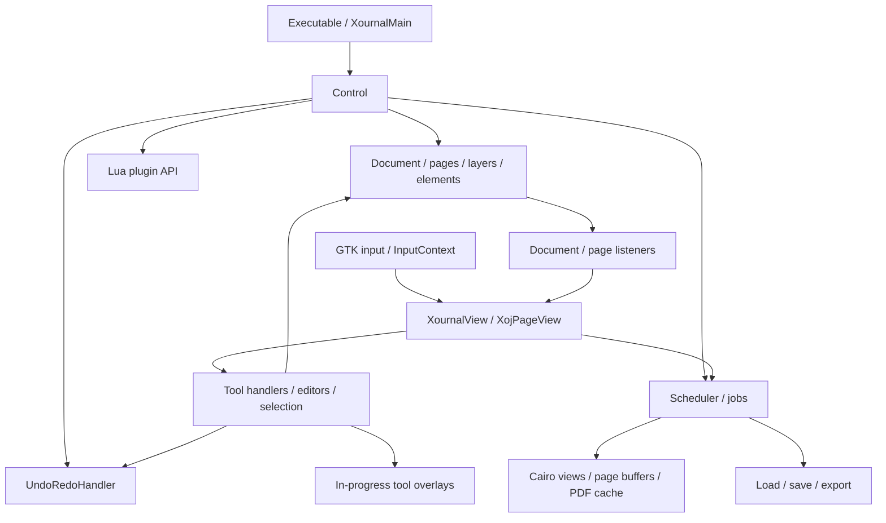

# Xournal++ source map, with collaboration context

This is a reference to the existing code, not an implementation plan. It records
where behavior lives and which existing assumptions matter to real-time shared
editing. It does not choose a synchronization algorithm, network transport,
server topology, hosting service, or collaboration UI.

Surveyed on **12 November 2026**, on branch `shared-xournal`, at source commit
`4d6810b3760c7b3f90c6a3271d6a5623cfb5481f`. The checkout identifies itself as
Xournal++ **1.3.8+dev**, uses C++20 and GTK 3, and writes file format version 5.
These are properties of this checkout, not claims about the latest upstream
release. The survey traced representative source paths; the application was not
built or exercised for this document.

## How to use this map

- [Repository and runtime](#repository-and-runtime): the broad layout and ownership.
- [Document model](#document-model): what a journal consists of and how objects are addressed.
- [Editing paths](#editing-paths): drawing, erasing, selecting, text, and structural edits.
- [History and notifications](#history-and-notifications): undo, dirty state, and redraw signals.
- [Rendering and transient state](#rendering-and-transient-state): what appears before an edit is committed.
- [Files and assets](#files-and-assets): persistence, loading, attachments, and clipboard serialization.
- [Threads and document lifetime](#threads-and-document-lifetime): background work and UI callbacks.
- [Collaboration lookup](#collaboration-lookup): concerns mapped to existing source owners.
- [Tests and survey boundaries](#tests-and-survey-boundaries): available evidence and remaining unknowns.

Source links are relative to this repository. Function names are included so the
map remains searchable when line numbers change. “Collaboration relevance” below
is an inference from the described code, not an implemented capability.

## Repository and runtime

| Location | Responsibility |
| --- | --- |
| [src/exe](src/exe) | Application entry point, crash wrapper, and platform setup. |
| [src/core/control](src/core/control) | Application coordination, tools, settings, actions, jobs, loading, and saving. |
| [src/core/model](src/core/model) | Document, pages, layers, elements, geometry, and change listeners. |
| [src/core/undo](src/core/undo) | Local undo/redo actions and emergency-save support. |
| [src/core/gui](src/core/gui) | Windows, page widgets, input devices, selection display, menus, dialogs, and sidebar. |
| [src/core/view](src/core/view) | Cairo drawing of model objects, backgrounds, and tool overlays. |
| [src/core/pdf](src/core/pdf) | PDF interfaces and Poppler implementation. |
| [src/core/plugin](src/core/plugin), [plugins](plugins) | Lua integration, application API, and bundled plugins. |
| [src/core/audio](src/core/audio) | Optional audio recording and playback; coordinated by `AudioController`. |
| [src/util](src/util) | Streams, serialization, geometry helpers, paths, GTK utilities, and resource wrappers. |
| [ui](ui), [resources](resources), [palettes](palettes), [po](po) | UI definitions/icons, templates, palettes, and translations. |
| [test](test) | GoogleTest unit/integration tests, benchmarks, and document fixtures. |
| [readme](readme), [development](development) | Build instructions and development material. |
| [CMakeLists.txt](CMakeLists.txt), [cmake](cmake), [.github/workflows](.github/workflows) | Build options/dependencies, generated configuration, and CI. Platform packaging also lives in the setup directories, `debian`, `rpm`, and `desktop`. |

The main executable links `xoj::core` and `xoj::util`. The core is a static library
containing model, controller, UI, and rendering code together; it is not a
headless document library. Model headers themselves refer to GTK/Cairo types.
See [src/CMakeLists.txt](src/CMakeLists.txt) and
[src/core/CMakeLists.txt](src/core/CMakeLists.txt).

Startup runs through [Xournalpp.cpp](src/exe/Xournalpp.cpp), then
[XournalMain.cpp](src/core/control/XournalMain.cpp). `XournalMain` sets up the GTK
application, `Control`, `MainWindow`, and scheduler lifecycle. The GTK application
uses `G_APPLICATION_NON_UNIQUE`; this application setup is not an internet
collaboration service.

[Control](src/core/control/Control.h) is the main coordination point. Its
constructor creates the document, undo handler, settings, tools, scheduler,
layer controller, and plugin controller. It also handles document replacement,
page operations, save/open/close, clipboard integration, and window state.

The broad relationships are:



This is a relationship diagram, not a universal edit sequence. Tools, plugins,
controllers, and undo actions can all mutate model objects.

## Document model

```text
Document
  ordered vector<PageRef>                 PageRef = shared_ptr<XojPage>
    XojPage
      dimensions and background
      ordered vector<Layer*>
        Layer
          name and visibility
          ordered vector<unique_ptr<Element>>
            Stroke | Text | Image | TexImage | Link
```

Primary definitions:

- [Document.h](src/core/model/Document.h): page ordering, journal/PDF paths,
  PDF document, preview, backup settings, and document lock.
- [XojPage.h](src/core/model/XojPage.h): page dimensions/background, layers,
  selected layer, PDF background page number, and page-change notifications.
- [Layer.h](src/core/model/Layer.h): element ownership and stacking order,
  insertion/removal, visibility, name, and cloning.
- [Element.h](src/core/model/Element.h): type, color, bounds, movement, scaling,
  rotation, cloning, and object serialization.
- [PageRef.h](src/core/model/PageRef.h),
  [ElementInsertionPosition.h](src/core/model/ElementInsertionPosition.h):
  local references and positions used throughout editing and history.

### Identity and ordering

The surveyed document/page/layer/element definitions and XML attributes do not
provide persistent collaboration IDs, author IDs, operation IDs, or revision
numbers. `PageRef` preserves local object lifetime; it does not identify a page
across processes. `Layer::Index`, `Element::Index`, and the selected-layer “ID”
are positions. Element lookup commonly compares pointers.

Page order, layer order, and element order are significant. Removal/undo code
retains positions, and selections preserve insertion order. Inserting or
removing a neighboring object changes numeric positions. Cloning is already
used for duplication and copying; the code has no shared identity policy for
those copies.

**Collaboration relevance:** independently loaded copies cannot address the same
object using these pointers. Targeting edits and preserving order under
simultaneous insertions touches these model and serialization boundaries.

### Element content and coordinates

- [Stroke](src/core/model/Stroke.h) stores points, pressure-related widths,
  tool/style, fill, cap style, and optional audio association. Shapes generated
  by drawing tools are also strokes.
- [RectangularElement](src/core/model/RectangularElement.h) supplies affine
  transformations for text, images, TeX images, and links. Its matrix maps
  element coordinates into page coordinates.
- [Text](src/core/model/Text.h) holds a complete string, font, wrapping,
  alignment, justification, and a local `inEditing` flag.
- [Image](src/core/model/Image.h) owns image bytes and lazily renders a surface.
- [TexImage](src/core/model/TexImage.h) holds LaTeX source and rendered PDF or
  legacy PNG data.
- [Link](src/core/model/Link.h) is an editable link element; PDF navigation and
  bookmarks also use [LinkDestination](src/core/model/LinkDestination.h).
- [AudioContent](src/core/model/AudioContent.h) associates strokes/text with
  an audio filename and timestamp. That timestamp is audio playback timing,
  not a collaboration revision or causal clock.

[PositionInputData](src/core/gui/inputdevices/PositionInputData.h) carries
page-relative pixel input, pressure, device identity, and input time. Tools such
as `StrokeHandler` divide by zoom to obtain page coordinates. Layout position,
zoom, and display scaling belong to the local view.

## Editing paths

### Input and action routing

[InputContext](src/core/gui/inputdevices/InputContext.h) connects GTK events to
mouse, stylus, touch, keyboard, and geometry-tool handlers.
[XournalView](src/core/gui/XournalView.h) manages the journal view, layout, and
selection. **The class `XojPageView` is defined in
[gui/PageView.h](src/core/gui/PageView.h)**; there is no `XojPageView.h`.
Its press/motion/release handlers dispatch into individual tools and editors.

Menus, buttons, and shortcuts use
[ActionDatabase](src/core/control/actions/ActionDatabase.h),
[ActionProperties](src/core/control/actions/ActionProperties.h), and
[Action.enum.h](src/core/enums/Action.enum.h). These are GTK action definitions
and callbacks, including local tool/view actions and actions that open dialogs.
They are not a complete, serializable stream of document operations.

### Representative trace: freehand drawing

Source: [StrokeHandler.cpp](src/core/control/tools/StrokeHandler.cpp),
[InputHandler.cpp](src/core/control/tools/InputHandler.cpp),
[StrokeStabilizer.cpp](src/core/control/tools/StrokeStabilizer.cpp).

1. `XojPageView::onButtonPressEvent` creates the appropriate drawing handler
   and its overlay view.
2. `StrokeHandler::onButtonPressEvent` creates a tool-configured `Stroke` held
   by the handler, converts coordinates, and initializes stabilization.
3. Motion passes through the stabilizer. `paintTo` and `drawSegmentTo` append
   points and dispatch incremental overlay updates. The stroke is not yet in
   the layer's element vector.
4. On release, `finalizeStroke` finishes stabilization and point/pressure details.
   The handler records an `InsertUndoAction`, then adds the stroke to the
   selected layer under the document lock.
5. The overlay is finalized into the page buffer, and `fireElementChanged`
   notifies page listeners. Cancellation instead discards the pending stroke.

There are branches: shape recognition can replace the freehand stroke and use
`RecognizerUndoAction`; a user setting can automatically append a page when
drawing on the last page. Shape and spline handling also lives in
[control/tools](src/core/control/tools), notably `BaseShapeHandler` and
`SplineHandler`; spline completion can span multiple input sequences.

**Collaboration relevance:** the live preview, final inserted object, canceled
gesture, and any automatic page insertion are distinct pieces of behavior.
Observing layer insertions alone sees completed strokes, not live pen movement.

### Erasing

[EraseHandler.cpp](src/core/control/tools/EraseHandler.cpp) implements whole-stroke
deletion and partial erasing. Whole-stroke deletion removes elements and collects
them in `DeleteUndoAction`. Partial erasing attaches an
[ErasableStroke](src/core/model/eraser/ErasableStroke.h) to the original stroke
and updates the visible erasure as the gesture proceeds.
[EraseUndoAction::finalize](src/core/undo/EraseUndoAction.cpp) removes the original
and inserts the resulting stroke fragments, retaining originals for undo.
Whiteout is not handled by `EraseHandler`.

**Collaboration relevance:** partial erasure changes object structure; it is not
just deletion of one element. Concurrent changes can target an original stroke
whose visible result has become several replacement strokes.

### Selection, transformations, and vertical space

[EditSelection.cpp](src/core/control/tools/EditSelection.cpp) contains
`SelectionFactory` helpers that **remove selected objects from their layers**
and transfer ownership into
[EditSelectionContents](src/core/control/tools/EditSelectionContents.h).
The selection displays and transforms them. `finalizeSelection` returns them
to a destination layer, using saved insertion positions where applicable.

Selection edits include movement across pages/layers, rotation, scaling, style
changes, duplication, deletion, and stacking-order changes. Corresponding undo
classes include `MoveUndoAction`, `RotateUndoAction`, `ScaleUndoAction`,
`ArrangeUndoAction`, and the color/font/size/fill/line-style actions.

[VerticalToolHandler](src/core/control/tools/VerticalToolHandler.cpp) similarly
adopts a set of elements out of the layer, displays the spacing adjustment, then
moves and returns them when finalized.

**Collaboration relevance:** absence from a layer can mean “locally selected”
rather than “deleted.” Local selection ownership, saved positions, and remote
edits to selected objects intersect here. Reading only the document's layer
vectors can omit objects that the user still sees.

### Text editing

[TextEditor](src/core/control/tools/TextEditor.cpp) owns a GTK text buffer,
input-method/preedit handling, cursor/selection, and a working `Text` element.
`contentsChanged` currently contains a TODO to reinstate the text-editing undo
stack; it should not be assumed to provide per-keystroke undo. Existing text is
cloned by `initializeEditionAt`; the original is marked `inEditing` while the
editor displays the working copy.

`finalizeEdition` inserts new text, replaces an existing element with the working
copy using `TextBoxUndoAction`, or deletes an existing element if the buffer is
empty. The saved model contains a complete string, not a sequence of
collaborative character operations.

**Collaboration relevance:** editing the same text box involves both the working
buffer and the document element. Whole-element replacement and character-level
coediting would meet different boundaries here; this map chooses neither.

### Images, LaTeX, links, and clipboard

- [ImageHandler](src/core/control/tools/ImageHandler.cpp) loads images, scales
  them, and inserts them, including through selection-based interactions.
- [LatexController](src/core/control/LatexController.cpp) manages the TeX editor,
  asynchronous generation, and insertion/replacement of rendered `TexImage`s.
  [LatexGenerator](src/core/control/latex/LatexGenerator.cpp) owns generation work.
- [LinkHandler](src/core/control/tools/LinkHandler.cpp) creates and edits links;
  replacement can group delete/insert undo actions.
- [ClipboardHandler](src/core/control/ClipboardHandler.cpp), `Control::clipboardPaste*`,
  and `EditSelection` handle journal selections, text, and images. Pasted content
  can live in a selection before being returned to a layer.

These are additional edit entry points; pointer input does not cover them all.

### Page, layer, and background structure

- [Control.cpp](src/core/control/Control.cpp): `insertPage`, `deletePage`,
  `duplicatePage`, page moves, `paperFormat`, and document lifecycle.
- [LayerController](src/core/control/layer/LayerController.cpp): layer insertion,
  deletion, copying, moving, merging, renaming, selecting, and visibility.
- [PageBackgroundChangeController](src/core/control/PageBackgroundChangeController.cpp)
  and [PageTypeHandler](src/core/control/pagetype/PageTypeHandler.cpp): backgrounds,
  PDF page choices, and paper types/configuration.
- [undo](src/core/undo): matching page/layer/background actions, including
  `InsertDeletePageUndoAction`, `SwapUndoAction`, `MergeLayerDownUndoAction`,
  and `PageBackgroundChangedUndoAction`.

Layer mutations are meant to pass through `LayerController` so notifications are
sent; `LoadHandler` is also allowed to construct layers directly. Page deletion
in `Control` clears active editing state and sends its page-deleted notification
before removing the page. These methods carry UI and lifetime effects beyond
changing a vector.

**Collaboration relevance:** simultaneous structural edits interact with active
tools, selections, views, background assets, numeric positions, and undo history.

### Lua is another mutation surface

[PluginController](src/core/plugin/PluginController.cpp) loads plugins.
[luapi_application.h](src/core/plugin/luapi_application.h) implements the Lua
application API; [luapi_application.def.lua](plugins/luapi_application.def.lua)
describes it for plugin authors. It can add strokes, splines, text, images, and
links; manipulate pages/layers; and invoke application actions. Some insertion
APIs explicitly allow grouped, individual, or **no undo actions**.

**Collaboration relevance:** menu callbacks and undo registration are each
incomplete ways to observe all document mutations. Plugin writes are concrete
examples of paths that must be accounted for when reasoning about edit coverage.

## History and notifications

### Undo/redo and dirty state

[UndoRedoHandler](src/core/undo/UndoRedoHandler.cpp) owns local undo and redo
deques. `addUndoAction` records an action, clears redo, and notifies listeners;
it does **not** execute the edit. Initial mutations occur in their callers.
`undo` and `redo` later call the action's methods with `Control*`.

[UndoAction](src/core/undo/UndoAction.h) has affected page references, a display
description, and local execution state. Concrete actions retain element/layer
pointers, owned removed objects, old values, and insertion positions. They are
not serialized network commands. Some gestures register an action before the
gesture's contents are complete, as in erasing.

`isChanged` and `isChangedAutosave` compare the current history tail with
`savedUndo` and `autosavedUndo`. Saving updates these local markers; they do not
represent a shared document revision or acknowledgment from another participant.

**Collaboration relevance:** shared edits, local undo, removed-object ownership,
and save/autosave status meet here. Reusing this history as a replication log
would encounter pointers, missing edits, and different mutation timing.

### Three kinds of notification

| Mechanism | Existing payload and consumers | What it tells us |
| --- | --- | --- |
| [DocumentHandler / DocumentListener](src/core/model/DocumentHandler.h) | Document change type or numeric page position; consumed by journal view, sidebar, and controllers. | Structural/lifecycle and view updates. |
| [PageHandler / PageListener](src/core/model/PageHandler.h) | Element pointers, element lists, rectangles/ranges, or whole-page invalidation; consumed by page views. | What may need repainting, including old/new bounds supplied by callers. |
| [DispatchPool](src/util/include/util/DispatchPool.h) | Typed in-process calls from a tool to its overlay views, including finalization/cancellation. | In-progress display updates for that tool. |

These dispatch directly to local listeners. Page notifications do not consistently
distinguish insertion, deletion, and property changes, or carry before/after
content, authorship, or revision information. Raw model setters do not form a
universal mutation-notification layer.

There is also a slower preview-update route: undo notifications collect changed
pages in `Control::undoRedoPageChanged`; `checkChangedDocument` runs on a
five-second timer and notifies registered changed-document listeners. It is
separate from immediate page invalidation and live tool overlays.

**Collaboration relevance:** existing notifications are useful for displaying
applied changes, but do not by themselves describe a reproducible edit stream.

## Rendering and transient state

[XournalView](src/core/gui/XournalView.cpp) owns the journal layout and selection.
[XojPageView](src/core/gui/PageView.cpp) owns per-page buffers, active handlers,
editors, and overlays. `rerenderPage`/`rerenderRect` request rendering;
`repaintPage`/`repaintArea` request display updates.

[RenderJob](src/core/control/jobs/RenderJob.cpp) draws through
[DocumentView](src/core/view/DocumentView.cpp), `LayerView`, element views, and
background views into Cairo buffers. PDF backgrounds use
[PdfCache](src/core/control/PdfCache.h) and Poppler-backed PDF interfaces.
[RepaintHandler](src/core/gui/RepaintHandler.h) converts redraw requests into
widget updates. Sidebar previews use separate preview jobs.

[view/overlays](src/core/view/overlays) contains in-progress stroke/shape/text
views, selectors, laser pointers, and other temporary display objects.
`drawAndDeleteToolView` can finish a local tool by drawing its overlay directly
into the page buffer, avoiding a visual blink.

State boundaries currently cross model/UI ownership:

| State | Current location / behavior |
| --- | --- |
| Completed journal content | Document/pages/layers/elements, plus referenced asset bytes/files. |
| Pending freehand or shape | Tool handler and overlay; not necessarily inserted into a layer. |
| Active text edit | GTK buffer and working copy; original can remain marked `inEditing`. |
| Selected or vertically shifted objects | Temporarily owned outside their layer by editing tools. |
| Selected page/layer, visibility, zoom, scroll, active tool | Spread across page model, view/controllers, settings, and metadata. Their storage location does not determine whether they should be shared. |
| Laser pointer | Temporary strokes and fade timers in [LaserPointerHandler](src/core/control/tools/LaserPointerHandler.h) and its overlay. |
| Rendered buffers, thumbnails, bounds, PDF cache | Local derived display state. |

For example, `SaveHandler::visitLayer` writes layer names and elements, but not
the layer's visibility flag. Current page/zoom metadata is stored separately by
[MetadataManager](src/core/control/settings/MetadataManager.cpp). There is no
existing participant/presence registry or per-participant remote cursor model
in the surveyed paths.

**Collaboration relevance:** the overlay machinery is relevant to live remote
previews and presence; it currently follows local tool lifetimes. Applying a
completed remote edit also needs the appropriate invalidation/UI effects rather
than assuming a local gesture has already drawn its pixels.

## Files and assets

### Journal loading and saving

- [LoadHandler](src/core/control/xojfile/LoadHandler.h) opens journals and builds
  model objects through the
  [DocumentBuilderInterface](src/core/control/xojfile/DocumentBuilderInterface.h).
  [XmlParser](src/core/control/xojfile/XmlParser.h), `XmlParserHelper`, `XmlTags`,
  `XmlAttrs`, and `XmlValues` define parsing and vocabulary.
- The loader supports gzip XML and ZIP-packaged journals containing `content.xml`
  and attachments. Loading a packaged format does not imply saving uses it.
- [SaveHandler](src/core/control/xojfile/SaveHandler.cpp) is the normal writer.
  `prepareSave` walks the document and builds XML; `saveTo` writes gzip XML and
  associated background files; `updateDocumentInfo` applies resulting asset info.
  Some preparation, including attached-PDF handling, has filesystem side effects.
- [SaveJob](src/core/control/jobs/SaveJob.cpp) prepares the preview/snapshot,
  writes the file, handles backups, and resets saved status after success.
- [XojExportHandler](src/core/control/xojfile/XojExportHandler.h) supplies legacy
  Xournal export behavior. PDF/image exports have separate jobs and are rendered
  outputs rather than editable collaboration state.

`Control::saveImpl` calls `clearSelectionEndText` before scheduling normal saves,
which returns active selection/text content to a saveable state.
[AutosaveJob](src/core/control/jobs/AutosaveJob.cpp) has its own snapshot and
temporary-file/rename path and uses the undo-based autosave marker.
[CrashHandler](src/core/control/CrashHandler.cpp) supplies emergency-saving
behavior; startup checks for recovery in `XournalMain`. The
[EmergencySaveRestore](src/core/undo/EmergencySaveRestore.cpp) undo action only
marks a recovered document as changed; its undo/redo methods do nothing.
These are local persistence mechanisms, not reconnect/replay support.

The XML vocabulary has no persistent element/page/layer collaboration identity
or operation history. Numeric `fileversion` is a file-format version.

### Asset dependencies

A journal can depend on external or sidecar PDF backgrounds, image backgrounds,
and audio files. Images and TeX output also have embedded binary representations.
Packaged input supports attachments that the loader reads/extracts. The normal
writer can produce neighboring files such as attached backgrounds; external
paths can be relative or absolute.

Relevant owners are `Document::readPdf`/`setPdfAttributes`,
[BackgroundImage](src/core/model/BackgroundImage.h),
[PathUtil](src/util/include/util/PathUtil.h), `SaveHandler::visitPage`,
`LoadHandler::getAbsoluteFilepath`/`readZipAttachment`, and `AudioContent`.

**Collaboration relevance:** transferring only the journal XML or its local
filenames does not ensure another machine can reproduce the document. Snapshot
consistency also intersects with active selections and text copies. Asset
identity, availability, and received-data validation are separate concerns from
incremental geometry/text edits.

### Clipboard/object serialization is a separate format

`ClipboardHandler` writes the `application/xournal` selection format using
`EditSelection::serialize`, `ObjectOutputStream`, and `BinObjectEncoding`.
Elements implement `serialize`/`readSerialized`; utilities are in
[util/serializing](src/util/serializing) and
[its headers](src/util/include/util/serializing).

This existing format is not the journal XML format. The binary reader/writer
uses native representations, including `size_t`, and checks a serialization
version string. It provides useful object-content coverage but is not evidence
of a portable, validated internet protocol. It does not supply operation
identity, ordering, retries, or concurrent-edit semantics.

## Threads and document lifetime

[Document](src/core/model/Document.h) exposes an externally managed
`std::shared_mutex`: callers must lock around reads/writes. Render jobs acquire a
shared lock; editing code commonly takes the write lock around mutations.
Individual setters do not automatically acquire it.

[Scheduler](src/core/control/jobs/Scheduler.h) has a background worker and
priority queues. [XournalScheduler](src/core/control/jobs/XournalScheduler.cpp)
adds page-render/preview deduplication and removal, and can wait for running
work to finish before its source is removed. Jobs often retain view pointers.
`Job::callAfterRun` and
[Util::execInUiThread](src/util/include/util/Util.h) marshal callbacks through
GLib/GTK idle callbacks. `BlockingJob` coordinates blocking/unblocking local UI.

`Control::replaceDocument`, `closeDocument`, and `fileLoaded`, plus
`Document::operator=`, clear/replace document state, history, and views through
the existing lifecycle. File dialogs and LaTeX rendering also bring their own
asynchronous completion paths.

**Collaboration relevance:** document locks protect local memory access; they do
not resolve concurrent user edits. Received edits intersect with the GTK thread,
ongoing gestures, scheduled rendering/saving, and close/open transitions.
Callbacks or messages arriving after a document/view is replaced would need
unambiguous ownership and document association.

## Collaboration lookup

This table locates concerns; it does not prescribe changes or their order.

| Concern | Existing source owners | Current boundary to keep in view |
| --- | --- | --- |
| Addressing a shared object | `Document`, `XojPage`, `Layer`, `Element`, `PageRef`, `XmlAttrs` | Local pointers and positional indices; no persistent collaboration identity found. |
| Capturing document edits | Tool handlers, `Control`, `LayerController`, Lua API, undo actions | Mutations are distributed; GTK actions, undo entries, and repaint signals each miss information. |
| Live handwriting | `StrokeHandler`, `StrokeStabilizer`, `StrokeToolView`, `DispatchPool` | Pending points are displayed before layer insertion; cancellation and recognition have separate outcomes. |
| Selection and object transforms | `EditSelection`, `EditSelectionContents`, `VerticalToolHandler`, transform undo actions | Objects can be temporarily outside layers; transformations, order, and destination page/layer matter. |
| Shared text boxes | `TextEditor`, `Text`, `TextBoxUndoAction`, `TextEditionView` | GTK working buffer/copy, then whole-element insertion/replacement; per-keystroke undo stack is currently a TODO. |
| Erase versus concurrent edits | `EraseHandler`, `ErasableStroke`, `EraseUndoAction`, `DeleteUndoAction` | One stroke may become several fragments; originals are retained by history. |
| Shared page/layer structure | `Control` page methods, `LayerController`, background controller, structural undo actions | Index shifts, active editing, view invalidation, and assets interact. |
| Undo by a participant | `UndoRedoHandler`, concrete undo actions | One local history, raw references, ownership transfers, and redo clearing. No author model. |
| Dirty state / saved state | `UndoRedoHandler`, `Control::resetSavedStatus`, `SaveJob`, `AutosaveJob` | Saved markers track local history tail, not a shared revision. |
| Initial document transfer | `LoadHandler`, `XmlParser`, `SaveHandler`, `Document` | Whole-document formats and lifecycle exist; shared-session snapshot/revision semantics do not. |
| PDF/image/TeX/audio availability | Model asset classes, `PathUtil`, file handlers, PDF/audio controllers | Assets may be embedded, external, extracted, or sidecar files. |
| Showing received edits | Page/document listeners, `PageView`, `XournalView`, render/preview jobs | Notification and invalidation effects are separate from changing model data. |
| Participants, cursors, live previews | Overlays, `LaserPointerHandler`, local cursor/view state | Useful local rendering concepts, but no participant/session ownership or presence model found. |
| Internet connection/session lifecycle | No owning subsystem found in surveyed source/build declarations | No application collaboration transport, room/session service, authentication flow, shared operation log, or reconnect mechanism identified. |
| Connection callbacks and cleanup | `XournalMain`, `Control` lifecycle, scheduler, GLib/GTK dispatch | Worker/UI boundary and document/view lifetime already matter locally. |
| Sharing controls and status | `Action.enum.h`, `ActionProperties`, `ActionDatabase`, `MainWindow`, `ui`, settings | Existing action/dialog infrastructure; no collaboration workflow identified. |
| Dependencies and distribution | Root/src CMake files, CI, platform setup/packaging | Native C++/GTK dependency and multi-platform packaging boundaries. |

Existing GLib/GIO availability, URI links, and GTK application machinery do not
by themselves establish an application networking or collaboration layer.
The absence claims above are scoped to this checkout and source survey, not to
third-party projects, other branches, or arbitrary behavior a Lua plugin could
implement.

## Tests and survey boundaries

[test/CMakeLists.txt](test/CMakeLists.txt) defines `test-units`,
`test-gtk-integration`, and `benchmarks`. Tests are opt-in with `ENABLE_GTEST`;
GoogleTest can be supplied by the system or downloaded with `DOWNLOAD_GTEST`.
[test/README.md](test/README.md) explains test/build usage. Core and test source
lists use CMake globbing, so adding files needs a CMake regeneration.

Useful existing reference tests:

- [LoadHandlerTest.cpp](test/unit_tests/control/LoadHandlerTest.cpp): gzip/ZIP
  input, document structure and elements, file-version compatibility,
  load/save/load round trips, attachments, and relative paths.
- [ErasableStrokeTest.cpp](test/unit_tests/model/ErasableStrokeTest.cpp): partial
  erasure geometry.
- [ObjectIOStreamTest.cpp](test/unit_tests/util/ObjectIOStreamTest.cpp): object
  serialization round trips.
- [ActionDatabaseTest.cpp](test/unit_tests/control/ActionDatabaseTest.cpp): action
  target/signature consistency.
- Model/image/style/matrix/range tests and the fixtures under
  [test/files](test/files) supply further content and geometry examples.
- [fileLoadBenchmarkTest.cpp](test/benchmarks/fileLoadBenchmarkTest.cpp) measures
  file loading. The GTK integration suite currently covers palette settings.

No collaboration/convergence/reconnect test suite or dedicated undo-history
test file was identified in the enumerated tests. No tests were run for this
documentation-only survey.

The following remain intentionally unresolved: which edits are shared; whether
two users can edit the same text/object simultaneously; how conflicting edits
and participant undo behave; whether identity/session metadata belongs in saved
files; and who supplies hosting, persistence, access control, and asset storage.
These are product/protocol decisions, not conclusions of the source map.

The input/controller/model/history/file/rendering paths above were inspected in
detail. Platform packaging, every tool variant, PDF backend internals, audio
internals, arbitrary plugins, and all error/lifetime interleavings were not
exhaustively audited. This map is a navigation aid and a record of current
assumptions, not a correctness or security certification.
